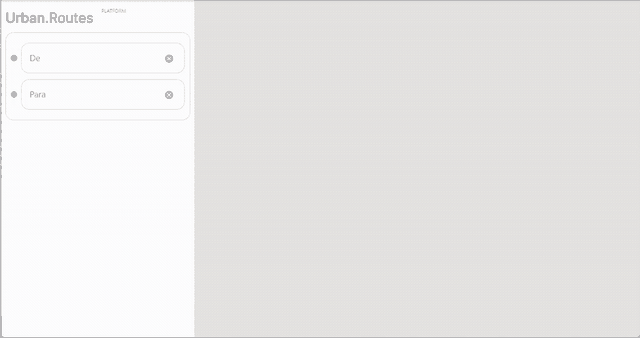

# Urban Routes | UI Automation Portfolio

End-to-end UI automation for a ride-booking web app, built with **Python, pytest, Selenium, and the Page Object Model**. The suite covers route validation, ride selection, phone confirmation, payment, ride requirements, and booking review. It includes both successful flows and negative checks.

> Portfolio adaptation of an educational test project. The suite targets an authorized, environment-specific Urban Routes instance. All sample phone, card, and route values are demo data.

## Booking flow

The animation below shows the complete booking scenario. It uses the sample data configured for this project.



## Coverage

| Area | Scenarios |
| --- | --- |
| Route | Enter origin and destination; reject a missing origin or destination |
| Ride selection | Select Personal mode and Comfort tariff |
| Phone | Submit a phone number, retrieve the test SMS code from Chrome performance logs, and reject an altered code |
| Payment | Add demo card details and verify that an empty card form does not advance |
| Ride options | Add a driver note, request a blanket, and set the ice cream quantity |
| Booking | Complete the flow and verify that the order dialog appears |

The suite currently collects **12 cases**, including two parametrized missing-route checks.

## Run locally

Requirements: Python 3.10+, Google Chrome, and an active authorized test instance.

```powershell
py -m venv .venv
.venv\Scripts\Activate.ps1
python -m pip install -r requirements.txt
Copy-Item .env.example .env
# Update URBAN_ROUTES_URL in .env if the test instance URL has changed.
python -m pytest -v
```

Selenium Manager resolves a compatible ChromeDriver. The environment URL can change when a new test instance is created; update `URBAN_ROUTES_URL` in `.env` before running the suite. The sample SMS lookup depends on the test app's network response and Chrome performance logs.

Run one scenario:

```powershell
python -m pytest -v main.py::TestUrbanRoutes::test_set_route
```

Run the negative scenarios:

```powershell
python -m pytest -v main.py::TestUrbanRoutes::test_incomplete_route_is_rejected main.py::TestUrbanRoutes::test_rejects_invalid_sms_code main.py::TestUrbanRoutes::test_rejects_empty_card_details
```

Pytest saves a final **browser viewport screenshot** for each case under `artifacts/screenshots/`. These local run artifacts are ignored by Git. To create a JUnit report:

```powershell
New-Item -ItemType Directory -Force artifacts/reports | Out-Null
python -m pytest -v --junitxml=artifacts/reports/results.xml
```

## Refresh the portfolio animation

The committed GIF is a compact recording from a successful local run. To regenerate it against the current test instance:

```powershell
python scripts/record_demo.py
```

The script saves browser viewport screenshots as an animated GIF at `docs/assets/urban-routes-booking.gif`. It requires the test app to be reachable and uses Pillow, which is already listed in `requirements.txt`. Review the GIF before publishing if you change the sample data.

## Configuration and privacy

Set `URBAN_ROUTES_URL`, `ADDRESS_FROM`, `ADDRESS_TO`, `PHONE_NUMBER`, `CARD_NUMBER`, `CARD_CODE`, and `MESSAGE_FOR_DRIVER` in `.env`. Never put real credentials, personal information, or payment details in `.env`, screenshots, or the portfolio GIF. `.env` is excluded from Git.

## Project structure

```text
main.py                    pytest scenarios
pages.py                   Page Object and UI actions
locators.py                centralized UI selectors
helpers.py                 test-environment SMS helper
data.py                    environment-based test configuration
conftest.py                browser fixture and local screenshots
scripts/record_demo.py     browser-only portfolio GIF recorder
docs/assets/               committed portfolio animation
```

## License

See [`LICENSE.chromedriver`](LICENSE.chromedriver) and [`THIRD_PARTY_NOTICES.chromedriver`](THIRD_PARTY_NOTICES.chromedriver) for the ChromeDriver notices. The ChromeDriver binary is not included.
